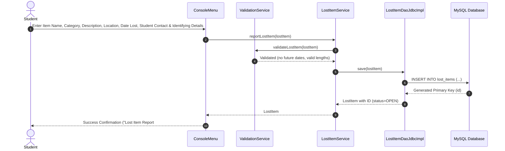
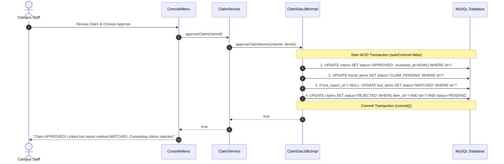
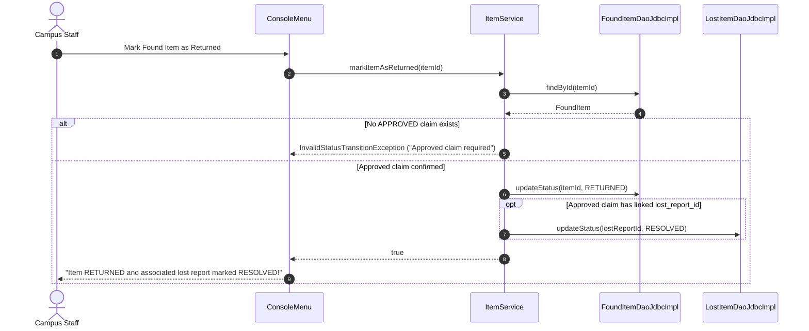

# CampusFind — Architecture & System Design

CampusFind is designed following the classic **Layered (N-Tier) Architecture** pattern. This architecture cleanly isolates user interface, business logic, data persistence, and database connectivity into distinct layers with unidirectional dependencies.

---

## 1. High-Level Architectural Flow

```
+-------------------------------------------------------------------------+
|                              UI LAYER                                   |
|   ConsoleMenu (User Input/Flow)  |  ConsolePrinter (Formatting/Tables)  |
+-------------------------------------------------------------------------+
                                    |
                                    v (Method Calls)
+-------------------------------------------------------------------------+
|                            SERVICE LAYER                                |
|   ItemService     |  LostItemService  |  ClaimService  |  Validation    |
|   - Business rules & state validation                                   |
|   - Multi-factor heuristic matching engine                              |
|   - Verification orchestration & privacy filters                        |
|   - Coordinates multi-entity workflows & status sync                    |
+-------------------------------------------------------------------------+
                                    |
                                    v (Interface Invocations)
+-------------------------------------------------------------------------+
|                              DAO LAYER                                  |
|   FoundItemDao (Interface)   |   LostItemDao (Interface)   | ClaimDao   |
|   FoundItemDaoJdbcImpl       |   LostItemDaoJdbcImpl       | ClaimDao.. |
|   - SQL PreparedStatements & query execution                            |
|   - ACID transaction boundaries (Commit & Rollback)                     |
|   - ResultSet mapping to Domain Entities                                |
+-------------------------------------------------------------------------+
                                    |
                                    v (JDBC API)
+-------------------------------------------------------------------------+
|                     CONFIGURATION & UTILITIES                           |
|   ConnectionFactory (DriverManager) | DatabaseConfig (Env/Properties)   |
+-------------------------------------------------------------------------+
                                    |
                                    v (TCP / Socket)
+-------------------------------------------------------------------------+
|                          DATABASE LAYER                                 |
|   MySQL 8.0+ (campusfind)                                               |
|   - Tables: found_items, lost_items, claims                             |
|   - Constraints: Primary Keys, Foreign Keys, CHECK constraints, Indexes |
+-------------------------------------------------------------------------+
```

---

## 2. Layer Responsibilities & Design Rationales

### A. Model Layer (`com.campusfind.model`)
- **Entities**: [`FoundItem`](file:///d:/desk/TalkAbtTech/PROJECT-S/campusFind/src/main/java/com/campusfind/model/FoundItem.java), [`LostItem`](file:///d:/desk/TalkAbtTech/PROJECT-S/campusFind/src/main/java/com/campusfind/model/LostItem.java), [`Claim`](file:///d:/desk/TalkAbtTech/PROJECT-S/campusFind/src/main/java/com/campusfind/model/Claim.java).
- **Enums**: [`ItemStatus`](file:///d:/desk/TalkAbtTech/PROJECT-S/campusFind/src/main/java/com/campusfind/model/ItemStatus.java), [`LostItemStatus`](file:///d:/desk/TalkAbtTech/PROJECT-S/campusFind/src/main/java/com/campusfind/model/LostItemStatus.java), [`ClaimStatus`](file:///d:/desk/TalkAbtTech/PROJECT-S/campusFind/src/main/java/com/campusfind/model/ClaimStatus.java).
- **DTOs**: [`MatchSuggestion`](file:///d:/desk/TalkAbtTech/PROJECT-S/campusFind/src/main/java/com/campusfind/model/MatchSuggestion.java), [`DashboardStatistics`](file:///d:/desk/TalkAbtTech/PROJECT-S/campusFind/src/main/java/com/campusfind/model/DashboardStatistics.java).
- **Core Principle**: Pure POJOs representing the domain model. Entities encapsulate data with private fields and public accessors. Crucially, their `toString()` implementations intentionally mask sensitive verification clues and identifying details (`[REDACTED]`) to prevent accidental disclosure via logger output or debugging traces.

### B. Service Layer (`com.campusfind.service`)
- **Classes**: [`ItemService`](file:///d:/desk/TalkAbtTech/PROJECT-S/campusFind/src/main/java/com/campusfind/service/ItemService.java), [`LostItemService`](file:///d:/desk/TalkAbtTech/PROJECT-S/campusFind/src/main/java/com/campusfind/service/LostItemService.java), [`ClaimService`](file:///d:/desk/TalkAbtTech/PROJECT-S/campusFind/src/main/java/com/campusfind/service/ClaimService.java), [`ValidationService`](file:///d:/desk/TalkAbtTech/PROJECT-S/campusFind/src/main/java/com/campusfind/service/ValidationService.java).
- **Core Principle**: Contains all business logic, invariant enforcement, matching heuristics, and domain rules.
  - *Why not put business rules in DAOs?* DAOs should only handle data retrieval and persistence. Putting business rules in DAOs tightly couples SQL with domain rules, making reuse and automated unit testing impossible.
  - *Why not put business rules in UI?* If UI changes (e.g. from console to REST API or web app), business rules would be lost or duplicated.

### C. DAO (Data Access Object) Layer (`com.campusfind.dao`)
- **Interfaces**: [`FoundItemDao`](file:///d:/desk/TalkAbtTech/PROJECT-S/campusFind/src/main/java/com/campusfind/dao/FoundItemDao.java), [`LostItemDao`](file:///d:/desk/TalkAbtTech/PROJECT-S/campusFind/src/main/java/com/campusfind/dao/LostItemDao.java), [`ClaimDao`](file:///d:/desk/TalkAbtTech/PROJECT-S/campusFind/src/main/java/com/campusfind/dao/ClaimDao.java).
- **Implementations**: [`FoundItemDaoJdbcImpl`](file:///d:/desk/TalkAbtTech/PROJECT-S/campusFind/src/main/java/com/campusfind/dao/FoundItemDaoJdbcImpl.java), [`LostItemDaoJdbcImpl`](file:///d:/desk/TalkAbtTech/PROJECT-S/campusFind/src/main/java/com/campusfind/dao/LostItemDaoJdbcImpl.java), [`ClaimDaoJdbcImpl`](file:///d:/desk/TalkAbtTech/PROJECT-S/campusFind/src/main/java/com/campusfind/dao/ClaimDaoJdbcImpl.java).
- **Core Principle**: Isolates SQL queries and JDBC boilerplates. By coding against interfaces, services depend on contracts rather than concrete database drivers, allowing seamless testing with in-memory test doubles (`InMemoryFoundItemDao`, `InMemoryLostItemDao`, `InMemoryClaimDao`).

### D. UI Layer (`com.campusfind.ui`)
- **Classes**: [`ConsoleMenu`](file:///d:/desk/TalkAbtTech/PROJECT-S/campusFind/src/main/java/com/campusfind/ui/ConsoleMenu.java), [`ConsolePrinter`](file:///d:/desk/TalkAbtTech/PROJECT-S/campusFind/src/main/java/com/campusfind/ui/ConsolePrinter.java).
- **Core Principle**: Strictly handles user input, menu presentation, and table formatting. Validates input syntax and displays friendly error messages when service exceptions are caught.

### E. Exception Hierarchy (`com.campusfind.exception`)
- All exceptions inherit from a base runtime exception [`CampusFindException`](file:///d:/desk/TalkAbtTech/PROJECT-S/campusFind/src/main/java/com/campusfind/exception/CampusFindException.java).
- Granular sub-exceptions: `ItemNotFoundException`, `LostItemNotFoundException`, `ClaimNotFoundException`, `InvalidStatusTransitionException`, `DuplicateClaimException`, `ValidationException`, `DatabaseOperationException`.

---

## 3. Key Feature Workflows

### 1. Reporting a Lost Item


### 2. Intelligent Heuristic Matching Engine
The matching engine in [`LostItemService.java`](file:///d:/desk/TalkAbtTech/PROJECT-S/campusFind/src/main/java/com/campusfind/service/LostItemService.java) compares an open lost report against all available found items using a weighted scoring model:
1. **Category Exact Match (+35 points)**: Same item category (e.g. `Electronics` == `Electronics`).
2. **Title & Description Keyword Overlap (+15 to +35 points)**: Tokenizes words (filtering stop words like "the", "with", "for", "left") and computes intersection between lost item and found item text.
3. **Location Proximity (+20 points)**: Checks if location names share keywords or substrings (e.g. "Library" in "Central Library" and "Library Reading Room").
4. **Chronological Plausibility (+10 points)**: Verifies that `dateFound >= dateLost`. If an item was found *before* the student lost it, timeline points are denied.
5. Suggestions scoring &ge; 40% are returned, sorted descending by match score, complete with an explanation list. **No automated state changes occur**; humans retain full verification authority.

### 3. Claim Submission with Lost Report Linkage
1. Student selects a Found Item ID, and optionally provides their Lost Report ID.
2. `ClaimService` verifies:
   - Found item exists and is not `RETURNED`.
   - If a `lostReportId` is provided, verifies that the lost report exists and is not already `RESOLVED`.
   - Student has no duplicate pending claim on the same found item.
3. Claim is inserted with status `PENDING`.
4. Found item status updates to `CLAIM_PENDING`.

### 4. Atomic Claim Approval & Status Synchronization


### 5. Returning an Item & Resolving the Lifecycle

