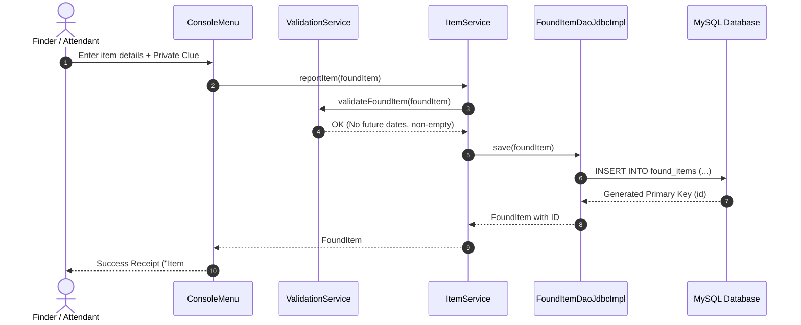
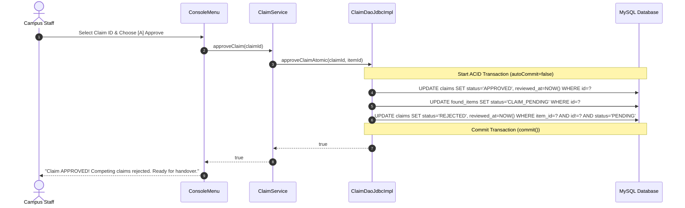
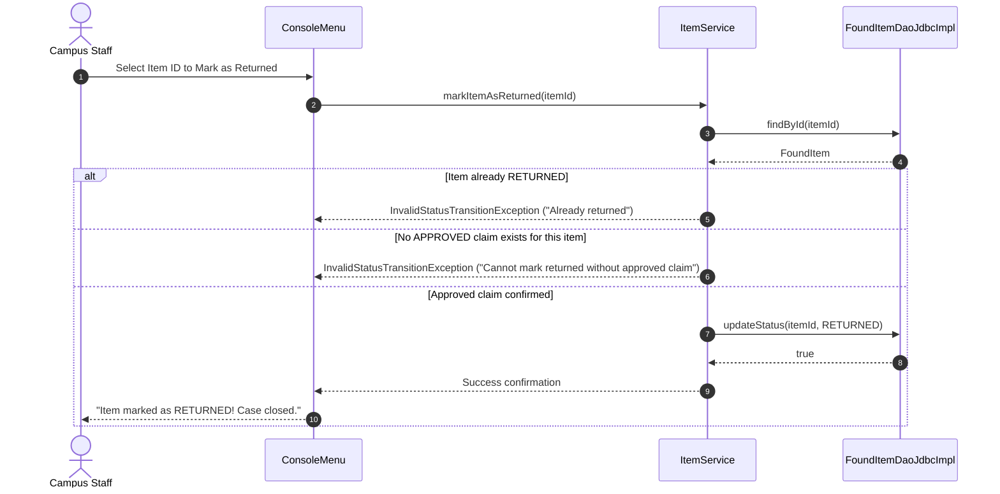

# CampusFind — Architecture & System Design

CampusFind is designed following the classic **Layered (N-Tier) Architecture** pattern. This architecture cleanly isolates user interface, business logic, data persistence, and database connectivity into distinct layers with unidirectional dependencies.

---

## 1. High-Level Architectural Flow

```
+-------------------------------------------------------------------------+
|                              UI LAYER                                   |
|   ConsoleMenu (User Input/Flow)  |  ConsolePrinter (Formatting/Tables)  |
+-------------------------------------------------------------------------+
                                    |
                                    v (Method Calls)
+-------------------------------------------------------------------------+
|                            SERVICE LAYER                                |
|   ItemService  |  ClaimService  |  ValidationService                    |
|   - Business rules & state validation                                   |
|   - Verification orchestration & privacy filters                        |
|   - Coordinates multi-entity workflows                                 |
+-------------------------------------------------------------------------+
                                    |
                                    v (Interface Invocations)
+-------------------------------------------------------------------------+
|                              DAO LAYER                                  |
|   FoundItemDao (Interface)   |   ClaimDao (Interface)                   |
|   FoundItemDaoJdbcImpl       |   ClaimDaoJdbcImpl                       |
|   - SQL PreparedStatements & query execution                            |
|   - ACID transaction boundaries (Commit & Rollback)                     |
|   - ResultSet mapping to Domain Entities                                |
+-------------------------------------------------------------------------+
                                    |
                                    v (JDBC API)
+-------------------------------------------------------------------------+
|                     CONFIGURATION & UTILITIES                           |
|   ConnectionFactory (DriverManager) | DatabaseConfig (Env/Properties)   |
+-------------------------------------------------------------------------+
                                    |
                                    v (TCP / Socket)
+-------------------------------------------------------------------------+
|                          DATABASE LAYER                                 |
|   MySQL 8.0+ (campusfind)                                               |
|   - Tables: found_items, claims                                         |
|   - Constraints: Primary Keys, Foreign Keys, CHECK constraints, Indexes |
+-------------------------------------------------------------------------+
```

---

## 2. Layer Responsibilities & Design Rationales

### A. Model Layer (`com.campusfind.model`)
- **Entities**: [`FoundItem`](file:///d:/desk/TalkAbtTech/PROJECT-S/campusFind/src/main/java/com/campusfind/model/FoundItem.java), [`Claim`](file:///d:/desk/TalkAbtTech/PROJECT-S/campusFind/src/main/java/com/campusfind/model/Claim.java).
- **Enums**: [`ItemStatus`](file:///d:/desk/TalkAbtTech/PROJECT-S/campusFind/src/main/java/com/campusfind/model/ItemStatus.java), [`ClaimStatus`](file:///d:/desk/TalkAbtTech/PROJECT-S/campusFind/src/main/java/com/campusfind/model/ClaimStatus.java), [`ItemCategory`](file:///d:/desk/TalkAbtTech/PROJECT-S/campusFind/src/main/java/com/campusfind/model/ItemCategory.java).
- **DTOs**: [`DashboardStatistics`](file:///d:/desk/TalkAbtTech/PROJECT-S/campusFind/src/main/java/com/campusfind/model/DashboardStatistics.java).
- **Core Principle**: Pure POJOs representing the domain model. Entities encapsulate data with private fields and public accessors. Crucially, their `toString()` implementations intentionally mask sensitive verification clues (`[REDACTED]`) to prevent accidental disclosure via logger output or debugging traces.

### B. Service Layer (`com.campusfind.service`)
- **Classes**: [`ItemService`](file:///d:/desk/TalkAbtTech/PROJECT-S/campusFind/src/main/java/com/campusfind/service/ItemService.java), [`ClaimService`](file:///d:/desk/TalkAbtTech/PROJECT-S/campusFind/src/main/java/com/campusfind/service/ClaimService.java), [`ValidationService`](file:///d:/desk/TalkAbtTech/PROJECT-S/campusFind/src/main/java/com/campusfind/service/ValidationService.java).
- **Core Principle**: Contains all business logic, invariant enforcement, and domain rules.
  - *Why not put business rules in DAOs?* DAOs should only handle data retrieval and persistence. Putting business rules in DAOs tightly couples SQL with domain rules, making reuse and automated unit testing impossible.
  - *Why not put business rules in UI?* If UI changes (e.g. from console to REST API or web app), business rules would be lost or duplicated.

### C. DAO (Data Access Object) Layer (`com.campusfind.dao`)
- **Interfaces**: [`FoundItemDao`](file:///d:/desk/TalkAbtTech/PROJECT-S/campusFind/src/main/java/com/campusfind/dao/FoundItemDao.java), [`ClaimDao`](file:///d:/desk/TalkAbtTech/PROJECT-S/campusFind/src/main/java/com/campusfind/dao/ClaimDao.java).
- **Implementations**: [`FoundItemDaoJdbcImpl`](file:///d:/desk/TalkAbtTech/PROJECT-S/campusFind/src/main/java/com/campusfind/dao/FoundItemDaoJdbcImpl.java), [`ClaimDaoJdbcImpl`](file:///d:/desk/TalkAbtTech/PROJECT-S/campusFind/src/main/java/com/campusfind/dao/ClaimDaoJdbcImpl.java).
- **Core Principle**: Isolates SQL queries and JDBC boilerplates. By coding against interfaces, services depend on contracts rather than concrete database drivers, allowing seamless testing with in-memory test doubles (`InMemoryFoundItemDao`, `InMemoryClaimDao`).

### D. UI Layer (`com.campusfind.ui`)
- **Classes**: [`ConsoleMenu`](file:///d:/desk/TalkAbtTech/PROJECT-S/campusFind/src/main/java/com/campusfind/ui/ConsoleMenu.java), [`ConsolePrinter`](file:///d:/desk/TalkAbtTech/PROJECT-S/campusFind/src/main/java/com/campusfind/ui/ConsolePrinter.java).
- **Core Principle**: Strictly handles user input, menu presentation, and table formatting. Validates input syntax and displays friendly error messages when service exceptions are caught.

### E. Exception Hierarchy (`com.campusfind.exception`)
- All exceptions inherit from a base runtime exception [`CampusFindException`](file:///d:/desk/TalkAbtTech/PROJECT-S/campusFind/src/main/java/com/campusfind/exception/CampusFindException.java).
- Granular sub-exceptions: `ItemNotFoundException`, `ClaimNotFoundException`, `InvalidStatusTransitionException`, `DuplicateClaimException`, `ValidationException`, `DatabaseOperationException`.

---

## 3. Key Feature Workflows

### 1. Reporting a Found Item


### 2. Submitting a Claim (Privacy-Conscious)
1. Claimant selects Item ID from public list.
2. `ClaimService` verifies:
   - Target item exists (throws `ItemNotFoundException` if not).
   - Item is not `RETURNED` (throws `InvalidStatusTransitionException`).
   - Claimant does not already have an active pending claim for this item (`DuplicateClaimException`).
3. Claimant enters general story and their **confidential answer** to the secret clue.
4. `ClaimDao` inserts the claim record with status `PENDING`.
5. If item was in `AVAILABLE` status, its status transitions to `CLAIM_PENDING`.

### 3. Claim Verification & Review
1. Campus staff/reviewer opens menu option `[7]` or `[8]`.
2. The UI retrieves the item and the claim.
3. The UI presents the **Confidential Verification Comparison Card**:
   - `Finder's Secret Clue` vs `Claimant's Verification Answer` side-by-side.
4. Staff determines if the claimant is legitimate without exposing the secret to anyone else.

### 4. Atomic Claim Approval & Competing Claims Resolution


### 5. Returning an Item (Mandatory Approval Invariant)


---

## 4. Concurrency & Transaction Trade-Offs

- **Chosen Approach**: Explicit local JDBC transactions via `Connection.setAutoCommit(false)`, `commit()`, and `rollback()`.
- **Competing Claims Resolution**: When an admin approves claim A for item X, any other pending claims (B, C) against item X are automatically transitioned to `REJECTED` inside the exact same database transaction.
- **Limitations**:
  - In a high-traffic production system with multiple concurrent administrators, row-level locking (`SELECT ... FOR UPDATE`) or optimistic concurrency version columns (`version INT`) would be used to prevent two admins from approving competing claims at the exact same millisecond. For this single-process campus console application, transactional commit guarantees atomicity and consistency without excessive locking overhead.
