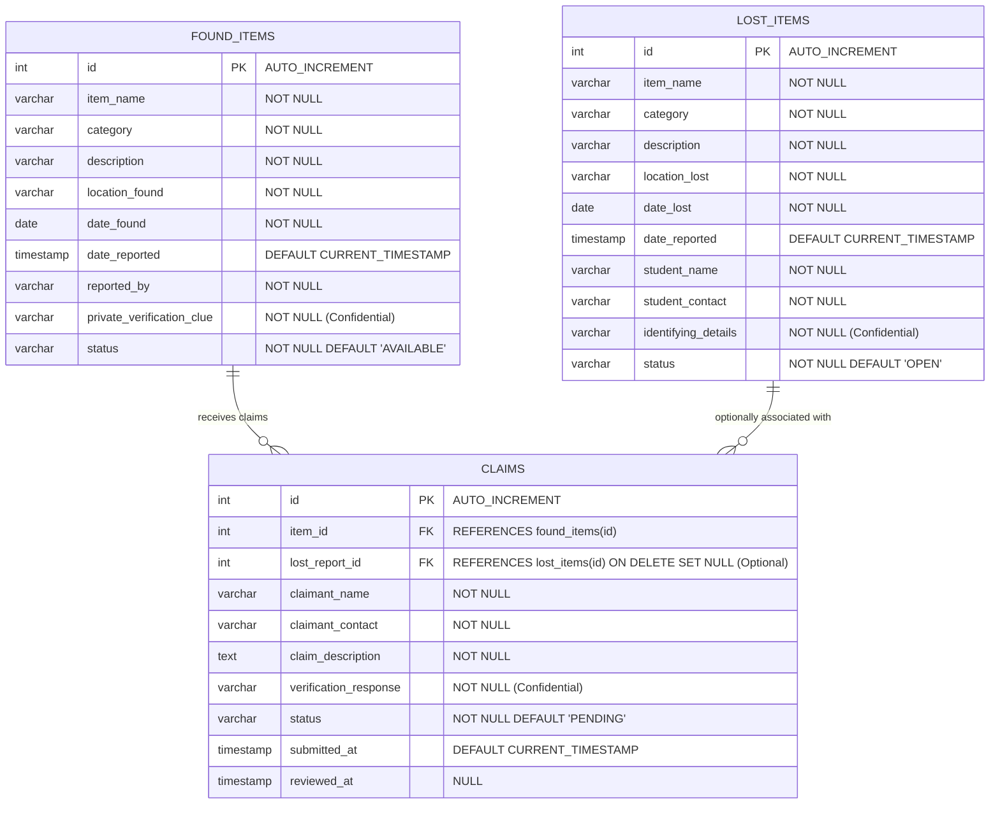

# CampusFind — Database Design & JDBC Architecture

This document covers the relational database schema, integrity constraints, indexing strategy, and JDBC transaction mechanics used in **CampusFind**.

---

## 1. Entity-Relationship Diagram (ERD)



---

## 2. Table Specifications & Constraints

### Table: `found_items`
| Column Name | SQL Type | Modifiers / Constraints | Purpose |
|---|---|---|---|
| `id` | `INT` | `AUTO_INCREMENT PRIMARY KEY` | Unique surrogate identifier for each reported found item. |
| `item_name` | `VARCHAR(100)` | `NOT NULL` | Short descriptive title of the found item. |
| `category` | `VARCHAR(50)` | `NOT NULL` | Broad classification (e.g., Electronics, Documents, Bags). |
| `description` | `VARCHAR(500)` | `NOT NULL` | Public description of the found item. |
| `location_found` | `VARCHAR(100)` | `NOT NULL` | Campus zone where item was picked up. |
| `date_found` | `DATE` | `NOT NULL` | Calendar date item was found. |
| `date_reported` | `TIMESTAMP` | `DEFAULT CURRENT_TIMESTAMP NOT NULL` | Exact system timestamp when logged. |
| `reported_by` | `VARCHAR(100)` | `NOT NULL` | Name and affiliation of finder/attendant. |
| `private_verification_clue` | `VARCHAR(255)` | `NOT NULL` | **Confidential** identifying clue known to finder and owner. |
| `status` | `VARCHAR(20)` | `NOT NULL DEFAULT 'AVAILABLE'` | Current lifecycle status (`AVAILABLE`, `CLAIM_PENDING`, `RETURNED`). |

**Table Constraints & Indexes**:
- `CONSTRAINT chk_item_status CHECK (status IN ('AVAILABLE', 'CLAIM_PENDING', 'RETURNED'))`: Enforces state integrity at the DB engine level.
- `INDEX idx_found_items_status (status)`: Accelerates queries listing available items.
- `INDEX idx_found_items_category (category)`: Accelerates category filter dropdowns.
- `INDEX idx_found_items_location (location_found)`: Speeds up location-based searches.
- `INDEX idx_found_items_date (date_found)`: Optimizes date range filters and orderings.

---

### Table: `lost_items`
| Column Name | SQL Type | Modifiers / Constraints | Purpose |
|---|---|---|---|
| `id` | `INT` | `AUTO_INCREMENT PRIMARY KEY` | Unique surrogate identifier for each lost item report. |
| `item_name` | `VARCHAR(100)` | `NOT NULL` | Name of the lost belonging. |
| `category` | `VARCHAR(50)` | `NOT NULL` | Category (e.g., Electronics, Books, Accessories). |
| `description` | `VARCHAR(500)` | `NOT NULL` | Public description and circumstances. |
| `location_lost` | `VARCHAR(100)` | `NOT NULL` | Location last seen or suspected lost. |
| `date_lost` | `DATE` | `NOT NULL` | Date when item was misplaced. |
| `date_reported` | `TIMESTAMP` | `DEFAULT CURRENT_TIMESTAMP NOT NULL` | System registration timestamp. |
| `student_name` | `VARCHAR(100)` | `NOT NULL` | Full name of the student. |
| `student_contact` | `VARCHAR(100)` | `NOT NULL` | Email or phone number for recovery notifications. |
| `identifying_details` | `VARCHAR(255)` | `NOT NULL` | **Confidential** private marks, serial fragments, stickers. |
| `status` | `VARCHAR(20)` | `NOT NULL DEFAULT 'OPEN'` | Lifecycle status (`OPEN`, `MATCHED`, `RESOLVED`). |

**Table Constraints & Indexes**:
- `CONSTRAINT chk_lost_item_status CHECK (status IN ('OPEN', 'MATCHED', 'RESOLVED'))`: Enforces valid lost report lifecycle states.
- `INDEX idx_lost_items_status (status)`: Accelerates queries for open lost items.
- `INDEX idx_lost_items_category (category)`: Accelerates category filtering and matching queries.
- `INDEX idx_lost_items_location (location_lost)`: Speeds up location filtering.
- `INDEX idx_lost_items_date (date_lost)`: Optimizes sorting by date lost.

---

### Table: `claims`
| Column Name | SQL Type | Modifiers / Constraints | Purpose |
|---|---|---|---|
| `id` | `INT` | `AUTO_INCREMENT PRIMARY KEY` | Unique identifier for the claim. |
| `item_id` | `INT` | `NOT NULL`, `FK -> found_items(id)` | Identifies which found item is being claimed. |
| `lost_report_id` | `INT` | `NULL`, `FK -> lost_items(id)` | Optional link to the student's open lost report. |
| `claimant_name` | `VARCHAR(100)` | `NOT NULL` | Student/claimant's full name. |
| `claimant_contact` | `VARCHAR(100)` | `NOT NULL` | Email or phone number for communication. |
| `claim_description` | `TEXT` | `NOT NULL` | Context on when/where claimant lost their item. |
| `verification_response` | `VARCHAR(255)` | `NOT NULL` | **Confidential** answer to secret verification clue. |
| `status` | `VARCHAR(20)` | `NOT NULL DEFAULT 'PENDING'` | Evaluation status (`PENDING`, `APPROVED`, `REJECTED`). |
| `submitted_at` | `TIMESTAMP` | `DEFAULT CURRENT_TIMESTAMP NOT NULL` | Submission timestamp. |
| `reviewed_at` | `TIMESTAMP` | `NULL` | When staff reviewed and made decision. |

**Table Constraints & Indexes**:
- `CONSTRAINT fk_claims_found_items FOREIGN KEY (item_id) REFERENCES found_items(id) ON DELETE RESTRICT ON UPDATE CASCADE`: Prevents deleting a found item if claims reference it.
- `CONSTRAINT fk_claims_lost_items FOREIGN KEY (lost_report_id) REFERENCES lost_items(id) ON DELETE SET NULL ON UPDATE CASCADE`: Links claim to lost report without blocking deletion of archived lost reports.
- `CONSTRAINT chk_claim_status CHECK (status IN ('PENDING', 'APPROVED', 'REJECTED'))`: Enforces valid claim states.
- `INDEX idx_claims_item_id (item_id)`: Speeds up finding all claims for an item.
- `INDEX idx_claims_lost_report (lost_report_id)`: Accelerates claim lookups by lost report ID.
- `INDEX idx_claims_status (status)`: Optimizes reviewer pending claim lookups.

---

## 3. Non-Destructive Database Migration

When upgrading an existing CampusFind deployment to version 2 (with lost items and matching):
- Existing tables and rows in `found_items` and `claims` **must not be deleted**.
- The script `src/main/resources/db/migration_v2_lost_items.sql` uses `CREATE TABLE IF NOT EXISTS` and `ALTER TABLE` to add `lost_items` and `claims.lost_report_id` safely:

```sql
-- Safe migration:
CREATE TABLE IF NOT EXISTS lost_items (
    id INT AUTO_INCREMENT PRIMARY KEY,
    item_name VARCHAR(100) NOT NULL,
    category VARCHAR(50) NOT NULL,
    description VARCHAR(500) NOT NULL,
    location_lost VARCHAR(100) NOT NULL,
    date_lost DATE NOT NULL,
    date_reported TIMESTAMP NOT NULL DEFAULT CURRENT_TIMESTAMP,
    student_name VARCHAR(100) NOT NULL,
    student_contact VARCHAR(100) NOT NULL,
    identifying_details VARCHAR(255) NOT NULL,
    status VARCHAR(20) NOT NULL DEFAULT 'OPEN',
    CONSTRAINT chk_lost_item_status CHECK (status IN ('OPEN', 'MATCHED', 'RESOLVED'))
) ENGINE=InnoDB DEFAULT CHARSET=utf8mb4 COLLATE=utf8mb4_unicode_ci;

-- Add lost_report_id column and foreign key to existing claims table
ALTER TABLE claims ADD COLUMN lost_report_id INT NULL AFTER item_id;
ALTER TABLE claims ADD CONSTRAINT fk_claims_lost_items FOREIGN KEY (lost_report_id)
    REFERENCES lost_items(id) ON DELETE SET NULL ON UPDATE CASCADE;
```

---

## 4. ACID Transactions & Atomic Status Synchronization

### The Business Workflow
When a campus administrator approves a claim:
1. Target claim status transitions from `PENDING` to `APPROVED`.
2. Found item status updates to `CLAIM_PENDING`.
3. Other competing pending claims on the same found item are automatically `REJECTED`.
4. If the claim was linked to an open lost report (`lost_report_id != null`), the lost report status transitions to `MATCHED`.

If any step fails, the entire transaction is rolled back so the database is never left in a desynchronized or partial state.

### The Implementation in [`ClaimDaoJdbcImpl.java`](file:///d:/desk/TalkAbtTech/PROJECT-S/campusFind/src/main/java/com/campusfind/dao/ClaimDaoJdbcImpl.java)
```java
Connection conn = null;
try {
    conn = ConnectionFactory.getConnection();
    // 1. Disable Auto-Commit to begin local transaction
    conn.setAutoCommit(false);

    // 2. Step 1: Update target claim to APPROVED
    try (PreparedStatement psClaim = conn.prepareStatement(approveClaimSql)) {
        psClaim.setInt(1, claimId);
        int rows = psClaim.executeUpdate();
        if (rows == 0) {
            conn.rollback();
            return false;
        }
    }

    // 3. Step 2: Update item status to CLAIM_PENDING
    try (PreparedStatement psItem = conn.prepareStatement(updateItemSql)) {
        psItem.setInt(1, itemId);
        psItem.executeUpdate();
    }

    // 4. Step 3: Check for linked lost report and set status to MATCHED
    Integer lostReportId = findLostReportId(conn, claimId);
    if (lostReportId != null) {
        try (PreparedStatement psLost = conn.prepareStatement(updateLostSql)) {
            psLost.setString(1, "MATCHED");
            psLost.setInt(2, lostReportId);
            psLost.executeUpdate();
        }
    }

    // 5. Step 4: Auto-reject competing pending claims
    try (PreparedStatement psReject = conn.prepareStatement(rejectOtherClaimsSql)) {
        psReject.setInt(1, itemId);
        psReject.setInt(2, claimId);
        psReject.executeUpdate();
    }

    // 6. Commit all changes atomically
    conn.commit();
    return true;

} catch (SQLException e) {
    if (conn != null) {
        conn.rollback(); // Rollback all steps on failure
    }
    throw new DatabaseOperationException("Transaction failed: " + e.getMessage(), e);
} finally {
    if (conn != null) {
        conn.setAutoCommit(true);
        conn.close();
    }
}
```

### Full Lifecycle Resolution
When the student physically collects the item:
- `ItemService.markItemAsReturned(itemId)` checks for an `APPROVED` claim.
- Marks `found_items.status = 'RETURNED'`.
- Automatically marks the associated `lost_items.status = 'RESOLVED'`.
- State transitions follow a strict, irreversible sequence:
  - Found Item: `AVAILABLE` &rarr; `CLAIM_PENDING` &rarr; `RETURNED`
  - Lost Report: `OPEN` &rarr; `MATCHED` &rarr; `RESOLVED`
