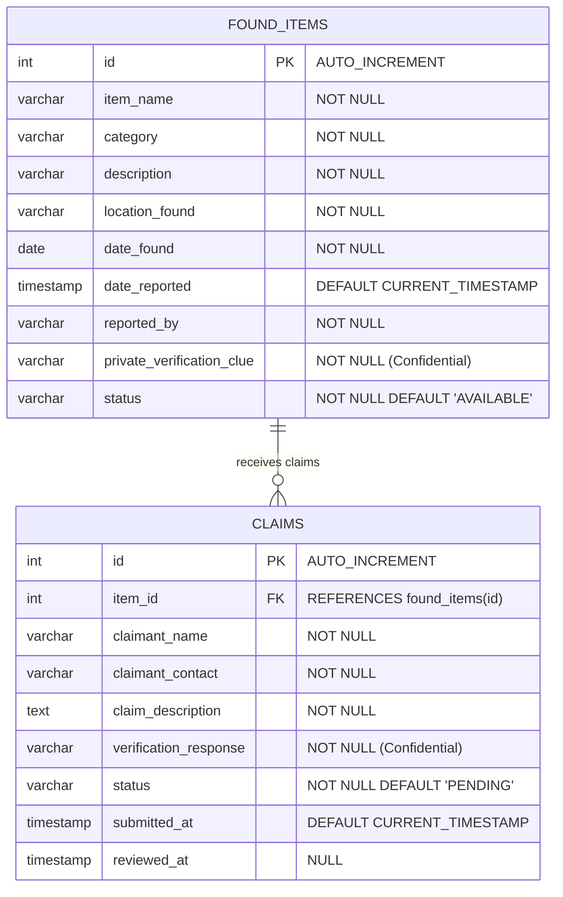

# CampusFind — Database Design & JDBC Architecture

This document covers the relational database schema, integrity constraints, indexing strategy, and JDBC transaction mechanics used in **CampusFind**.

---

## 1. Entity-Relationship Diagram (ERD)



---

## 2. Table Specifications & Constraints

### Table: `found_items`
| Column Name | SQL Type | Modifiers / Constraints | Purpose |
|---|---|---|---|
| `id` | `INT` | `AUTO_INCREMENT PRIMARY KEY` | Unique surrogate identifier for each reported item. |
| `item_name` | `VARCHAR(100)` | `NOT NULL` | Short descriptive title of the found item. |
| `category` | `VARCHAR(50)` | `NOT NULL` | Broad classification (e.g., Electronics, Documents). |
| `description` | `VARCHAR(500)` | `NOT NULL` | Public description of the item. |
| `location_found` | `VARCHAR(100)` | `NOT NULL` | Campus zone where item was picked up. |
| `date_found` | `DATE` | `NOT NULL` | Calendar date item was found. |
| `date_reported` | `TIMESTAMP` | `DEFAULT CURRENT_TIMESTAMP NOT NULL` | Exact system timestamp when logged. |
| `reported_by` | `VARCHAR(100)` | `NOT NULL` | Name and affiliation of finder/attendant. |
| `private_verification_clue` | `VARCHAR(255)` | `NOT NULL` | **Confidential** identifying clue known to finder and owner. |
| `status` | `VARCHAR(20)` | `NOT NULL DEFAULT 'AVAILABLE'` | Current lifecycle status. |

**Table Constraints & Indexes**:
- `CONSTRAINT chk_item_status CHECK (status IN ('AVAILABLE', 'CLAIM_PENDING', 'RETURNED'))`: Enforces state integrity at the DB engine level.
- `INDEX idx_found_items_status (status)`: Accelerates queries listing available items.
- `INDEX idx_found_items_category (category)`: Accelerates category filter dropdowns.
- `INDEX idx_found_items_location (location_found)`: Speeds up location-based searches.
- `INDEX idx_found_items_date (date_found)`: Optimizes date range filters and orderings.

---

### Table: `claims`
| Column Name | SQL Type | Modifiers / Constraints | Purpose |
|---|---|---|---|
| `id` | `INT` | `AUTO_INCREMENT PRIMARY KEY` | Unique identifier for the claim. |
| `item_id` | `INT` | `NOT NULL`, `FK -> found_items(id)` | Identifies which item is being claimed. |
| `claimant_name` | `VARCHAR(100)` | `NOT NULL` | Student/claimant's full name. |
| `claimant_contact` | `VARCHAR(100)` | `NOT NULL` | Email or phone number for communication. |
| `claim_description` | `TEXT` | `NOT NULL` | Context on when/where claimant lost their item. |
| `verification_response` | `VARCHAR(255)` | `NOT NULL` | **Confidential** answer to secret verification clue. |
| `status` | `VARCHAR(20)` | `NOT NULL DEFAULT 'PENDING'` | Evaluation status (`PENDING`, `APPROVED`, `REJECTED`). |
| `submitted_at` | `TIMESTAMP` | `DEFAULT CURRENT_TIMESTAMP NOT NULL` | Submission timestamp. |
| `reviewed_at` | `TIMESTAMP` | `NULL` | When staff reviewed and made decision. |

**Table Constraints & Indexes**:
- `CONSTRAINT fk_claims_found_items FOREIGN KEY (item_id) REFERENCES found_items(id) ON DELETE RESTRICT ON UPDATE CASCADE`: Prevents deleting an item if active claims reference it.
- `CONSTRAINT chk_claim_status CHECK (status IN ('PENDING', 'APPROVED', 'REJECTED'))`: Enforces valid claim states.
- `INDEX idx_claims_item_id (item_id)`: Speeds up finding all claims for an item.
- `INDEX idx_claims_status (status)`: Optimizes reviewer pending claim lookups.

---

## 3. Why JDBC & PreparedStatement?

### A. PreparedStatement vs Statement
In CampusFind, **100% of SQL queries with user parameters use `PreparedStatement`**.

1. **SQL Injection Defense**:
   If user input is concatenated:
   ```java
   // VULNERABLE:
   String sql = "SELECT * FROM found_items WHERE item_name = '" + userInput + "'";
   ```
   An attacker entering `' OR '1'='1` would dump the entire database including confidential verification clues.
   With `PreparedStatement`:
   ```java
   // SECURE:
   String sql = "SELECT * FROM found_items WHERE item_name = ?";
   PreparedStatement ps = conn.prepareStatement(sql);
   ps.setString(1, userInput);
   ```
   The database driver treats the parameter as raw literal data, escaping all special SQL characters.

2. **Precompilation & Performance**:
   The database compiles the query execution plan once and reuses it across multiple executions with different parameter bindings.

3. **Automatic Type Mapping**:
   `Date.valueOf(localDate)` and `Timestamp.valueOf(localDateTime)` map seamlessly to SQL `DATE` and `TIMESTAMP` columns without fragile string conversions.

---

## 4. ACID Transactions & Rollback

### The Problem
When a campus staff member approves a claim:
1. Claim status must change from `PENDING` to `APPROVED`.
2. Item status must update to `CLAIM_PENDING`.
3. Other competing pending claims on the same item should be set to `REJECTED`.

If step 1 succeeds, but step 2 or 3 crashes (e.g. network partition or database constraint violation), the database would be left in an inconsistent state (a claim is approved, but competing claims remain pending or the item state is desynchronized).

### The Implementation in [`ClaimDaoJdbcImpl.java`](file:///d:/desk/TalkAbtTech/PROJECT-S/campusFind/src/main/java/com/campusfind/dao/ClaimDaoJdbcImpl.java#L133-L195)
```java
Connection conn = null;
try {
    conn = ConnectionFactory.getConnection();
    // 1. Disable Auto-Commit to begin local transaction
    conn.setAutoCommit(false);

    // 2. Step 1: Update target claim
    try (PreparedStatement psClaim = conn.prepareStatement(approveClaimSql)) {
        psClaim.setInt(1, claimId);
        int rows = psClaim.executeUpdate();
        if (rows == 0) {
            conn.rollback(); // Roll back if claim wasn't PENDING
            return false;
        }
    }

    // 3. Step 2: Update item status
    try (PreparedStatement psItem = conn.prepareStatement(updateItemSql)) {
        psItem.setInt(1, itemId);
        psItem.executeUpdate();
    }

    // 4. Step 3: Auto-reject competing claims
    try (PreparedStatement psReject = conn.prepareStatement(rejectOtherClaimsSql)) {
        psReject.setInt(1, itemId);
        psReject.setInt(2, claimId);
        psReject.executeUpdate();
    }

    // 5. Commit all changes atomically
    conn.commit();
    return true;

} catch (SQLException e) {
    if (conn != null) {
        // Rollback all changes on failure
        conn.rollback();
    }
    throw new DatabaseOperationException("Transaction failed: " + e.getMessage(), e);
} finally {
    if (conn != null) {
        conn.setAutoCommit(true);
        conn.close();
    }
}
```

This guarantees **Atomicity** (all 3 steps happen or none happen), **Consistency** (foreign keys and check constraints are respected), **Isolation** (uncommitted updates are invisible to other connections), and **Durability** (once committed, changes survive server restarts).
